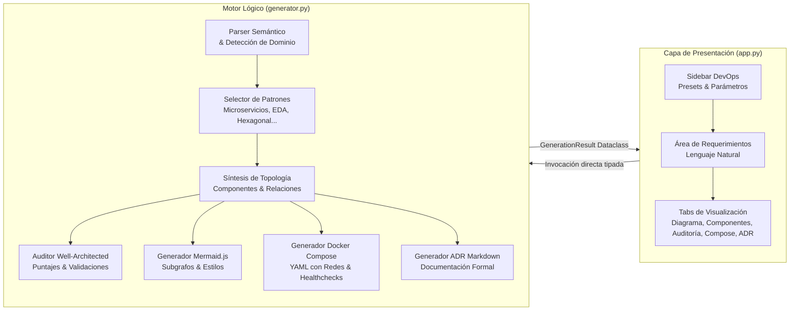

# 🏗️ ArchGen AI: Generador y Validador de Arquitecturas de Software

[](https://www.python.org/downloads/)
[](https://streamlit.io/)
[](https://www.docker.com/)
[](https://mermaid.js.org/)
[](https://opensource.org/licenses/MIT)
[](#-auditoría-well-architected)

**ArchGen AI** es una plataforma interactiva de ingeniería de software y DevOps diseñada para transformar requerimientos de negocio expresados en lenguaje natural en **arquitecturas de sistemas completas, robustas y listas para producción**.

El sistema opera de forma **100% independiente y local (offline)** mediante un motor de inferencia heurística y patrones de diseño avanzados, generando diagramas interactivos en **Mermaid.js**, especificaciones de orquestación en **Docker Compose** y un documento formal de decisiones técnicas (**ADR - Architecture Decision Record**).

---

## 🎯 Propósito y Valor de Ingeniería

En el ciclo de vida del desarrollo moderno de software y en entregas académicas de alto rigor, la transición desde los requerimientos abstractos hacia una topología de arquitectura técnica suele presentar desafíos:
1. **Falta de estándares:** Diseños inconsistentes que omiten capas críticas (seguridad perimetral, cachés, observabilidad).
2. **Dependencia de servicios externos:** Herramientas que fallan si no se dispone de una clave API de pago en la máquina del evaluador.
3. **Ausencia de validación formal:** Diagramas estéticos que no evalúan cuellos de botella, resiliencia ni riesgos de acoplamiento.

**ArchGen AI** soluciona esta brecha proporcionando un entorno de ingeniería que analiza, diseña, valida y emite artefactos reproducibles en segundos.

---

## ⚡ Características Principales

- **🧠 Motor Heurístico Autónomo (Zero-API Required):** Procesa texto libre en español o inglés mediante clasificación semántica, reglas de dominio y heurísticas de escalabilidad sin depender de APIs de terceros.
- **🗺️ Visualización Dinámica Mermaid.js:** Topologías organizadas en subgrafos por capas lógicas (`Clientes`, `Gateways`, `Seguridad`, `Dominio`, `Colas`, `Caché`, `Persistencia`, `Telemetría`) con renderizado en tiempo real y código exportable.
- **🛡️ Auditoría Well-Architected:** Evaluación algorítmica de los 5 pilares de ingeniería (Seguridad, Escalabilidad, Resiliencia, Observabilidad y Mantenibilidad) con detección de anti-patrones y cálculo de puntajes.
- **⚖️ Matriz de Compromisos (Trade-offs):** Identificación automática de compromisos técnicos (consistencia eventual vs. fuerte, granularidad de servicios vs. sobrecarga operativa, etc.).
- **🐳 Especificación Docker Compose:** Archivo `docker-compose.yml` completo con imágenes oficiales, healthchecks, mapeo de puertos, variables de entorno, redes aisladas (`public_net`, `backend_net`, `data_net`) y volúmenes con nombre.
- **📄 Generación de Reportes Técnicos (ADR):** Compilación de un Architecture Decision Record formal en formato Markdown con descarga en 1 clic.
- **🎨 Consola DevOps UI en Streamlit:** Interfaz interactiva de alta legibilidad, estética dark mode de ingeniería y presets de casos de estudio listos para evaluar.

---

## 📐 Arquitectura Interna de ArchGen AI

El sistema está construido bajo principios de modularidad, alta cohesión y bajo acoplamiento:



---

## 📁 Estructura del Repositorio

```text
archgen-ai/
│
├── requirements.txt      # Dependencias exactas del proyecto (Streamlit, Pandas, PyYAML)
├── generator.py          # Motor de análisis, síntesis topológica, Mermaid y Docker Compose
├── app.py                # Interfaz de usuario interactiva en Streamlit (Estilo DevOps Console)
└── README.md             # Documentación técnica completa en español
```

---

## 🚀 Guía de Instalación y Ejecución

Sigue estos pasos en **PowerShell (Windows)** o terminal de Linux/macOS para poner en marcha el proyecto:

### 1. Clonar o navegar al directorio del proyecto
```powershell
cd "c:\Users\org74\OneDrive\Desktop\api\lear machine\clase 3\generativa"
```

### 2. Crear y activar un entorno virtual de Python
```powershell
# Crear entorno virtual
python -m venv venv

# Activar en Windows PowerShell
.\venv\Scripts\Activate.ps1

# (En caso de restricción de scripts en Windows, habilitar temporalmente para la sesión):
# Set-ExecutionPolicy -Scope Process -ExecutionPolicy Bypass
```

### 3. Instalar las dependencias
```powershell
pip install --upgrade pip
pip install -r requirements.txt
```

### 4. Ejecutar la aplicación interactiva
```powershell
streamlit run app.py
```

La consola mostrará una URL local similar a `http://localhost:8501`. Ábrela en tu navegador web.

---

## 💻 Guía de Uso del Sistema

1. **Seleccionar un Caso de Estudio:** En la barra lateral izquierda, selecciona una de las plantillas precargadas (ej. *E-Commerce Distribuido*, *Core Bancario / Fintech*, *Telemetría IoT*, *Telemedicina HIPAA*, etc.) o elige *Personalizado* para redactar tus propios requerimientos.
2. **Ajustar Parámetros de Ingeniería:** Configura el patrón arquitectónico (o déjalo en *Auto-Detectar*), el perfil de carga estimada (ej. *Alta: 10k - 100k RPM*) y el marco de cumplimiento normativo (*Financiero*, *Salud*, etc.).
3. **Generar Arquitectura:** Haz clic en el botón principal **`⚡ GENERAR ARQUITECTURA`**.
4. **Explorar las Pestañas de Resultados:**
   - **🗺️ Diagrama Mermaid.js:** Inspecciona la topología interactiva, visualiza las capas y copia el código para Mermaid Live Editor, Obsidian o Notion.
   - **🧩 Desglose de Componentes:** Consulta la tabla interactiva y expande las fichas técnicas con detalles de puertos, stacks y roles.
   - **🛡️ Auditoría Well-Architected:** Revisa las calificaciones por pilar (Seguridad, Escalabilidad, etc.), alertas críticas y la matriz de trade-offs.
   - **🐳 Docker Compose DevOps:** Descarga el archivo `docker-compose.yml` listo para levantar localmente.
   - **📄 Reporte Técnico ADR:** Visualiza el registro formal de decisiones arquitectónicas y descárgalo en Markdown (.md).

---

## 🐳 Despliegue de la Infraestructura Generada

Para desplegar localmente cualquiera de las arquitecturas generadas por **ArchGen AI**:

```powershell
# 1. Descargar el archivo generado como 'docker-compose.yml' en un directorio nuevo
# 2. Levantar todos los contenedores en segundo plano
docker compose up -d

# 3. Validar el estado de salud y los puertos de escucha
docker compose ps

# 4. Ver los registros centralizados en vivo
docker compose logs -f --tail=100

# 5. Detener el entorno de laboratorio preservando la persistencia
docker compose down
```

---

## 🏛️ Patrones Arquitectónicos Soportados

| Patrón | Enfoque Principal | Casos de Uso Típicos |
|---|---|---|
| **Microservicios Distribuidos** | Desacoplamiento por dominio con límites de servicio autónomos | E-Commerce, Retail, Plataformas SaaS grandes |
| **Event-Driven Architecture (EDA)** | Coreografía asíncrona mediante buses de streaming | Streaming IoT, Notificaciones masivas, Telemetría |
| **Arquitectura Hexagonal (Ports & Adapters)** | Núcleo de dominio puro e independiente de frameworks | Fintech, Bancas, Motores de Cálculo Complejo |
| **CQRS y Event Sourcing** | Separación estricta de modelos de lectura y escritura | Sistemas de Auditoría Legal, Mercados Financieros |
| **Monolito Modular Ágil** | Cohesión interna alta con simplificación de despliegue | Startups, Productos MVP, Aplicaciones Internas |
| **Pipeline de Datos / Lakehouse** | Ingesta masiva y procesamiento ETL | Analítica en tiempo real, Big Data |

---

## 🧪 Pruebas Automatizadas del Motor Lógico

El motor lógico `generator.py` incluye un arnés de pruebas integrado que puede ejecutarse de forma independiente en consola para validar consistencia:

```powershell
python generator.py
```

Salida esperada:
```text
=== Plataforma de E-Commerce & Retail Distribuida ===
Patrón: Microservicios Distribuidos
Componentes: 14
Hallazgos de auditoría: 5
Salida de prueba generada con éxito.
```

---

## 🛡️ Licencia

Distribuido bajo la licencia **MIT**. Consulta el archivo `LICENSE` para más información.
Desarrollado para fines de investigación, ingeniería de sistemas y excelencia académica.
